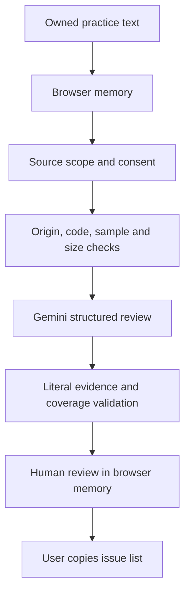

# Data flow

| Data | Origin | Processing/location | Retention/deletion |
|---|---|---|---|
| Raw item text | Editor or original example | Browser, same-origin server, optional Google API after consent | App memory only, reset/refresh clears browser state. Request memory discarded after response. Provider policies still apply |
| Decisions | Reviewer | Browser reducer | Reset or source edit clears. Clipboard export is user-controlled |
| Locale | User preference | Browser localStorage key bmcq.locale | Retained until changed/cleared. Values en/ta only |
| Demo code | Operator | Browser memory and request header, constant-time server comparison | Cleared on reset/refresh, never localStorage/logs |
| API key | Operator environment | Server-only | Hosting secret configuration controlled by operator |
| Operational event | App | Server platform logs | Request ID, duration, status only. No content/quotes/code/key/IP persistence added by app |

No upload/file boundary exists. JSON is treated as untrusted text. A privacy notice must describe cloud processing before an AI request. Host and provider logs are outside the app's own in-memory retention and prevent a promise of complete non-retention. Clipboard data is intentionally exported by the reviewer and cannot be recalled by this app.
