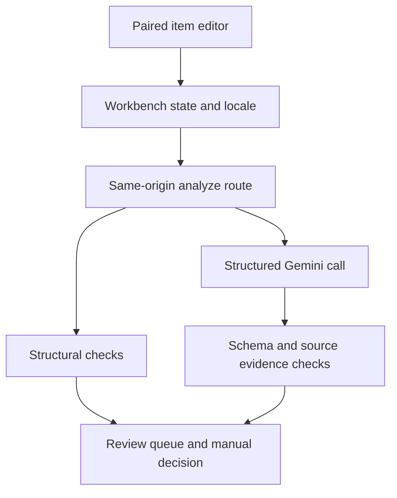

# System architecture

DECIDED design uses a single deployable Next.js application. `src/app/page.tsx` renders a client workbench and locale shell. `src/app/api/analyze/route.ts` validates source and returns deterministic plus validated model comparisons. `src/app/api/health/route.ts` reports configuration mode without disclosing secrets. `src/lib/core` contains pure rules. `src/lib/ai` is server-only. Shared schemas and types belong to `src/lib/contracts`.

Browser state contains raw items, current revision, operation ID, analysis results and reviewer actions. There is no server content database. The route performs one provider call for compatible items in the request. It checks origin, body size, mode, consent, access code if hosted, sample allowlist, schema and structural compatibility before inference. Rules-only mode never calls the provider.

Provider success is not directly rendered. Parse JSON, validate its schema, enforce exactly the expected item IDs, and compare each corresponding field's evidence with original strings. Invalid comparison coverage invalidates semantic status for that item. A material rule issue always makes its item `needs_review`. Probabilistic findings never remove deterministic findings.

No application runtime agents are used. No server cache is needed for MVP. Every displayed provider-backed result represents that request's outcome. A separately labelled replay fixture can be used during an outage, with a permanent replay banner and no claim of live inference.

The app is stateless between server requests. Locale is the sole localStorage entry. Current raw text, decisions and private demo access code remain in memory and clear on refresh/reset. Deployment hosting and provider infrastructure may retain service logs under their own policies. See PRIVACY_MODEL.md for the exact boundary.
