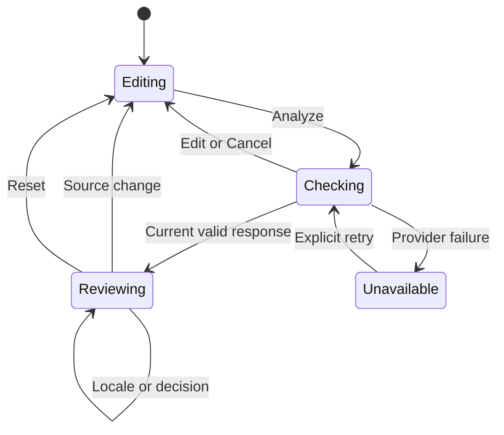

# Navigation and event flow

All states share route /. Only a source revision can invalidate content. Locale changes neither source nor request identity and must not trigger a provider call. A retry creates a new request ID. An old response cannot re-enter Reviewing after reset/edit. URLs carry no source, code or key.

Header navigation is limited to language and an in-page Help control. Desktop uses a two-column working region; mobile uses a single logical order with source editors followed by action and results. Internal headings and item buttons provide navigation without a second routing system.
