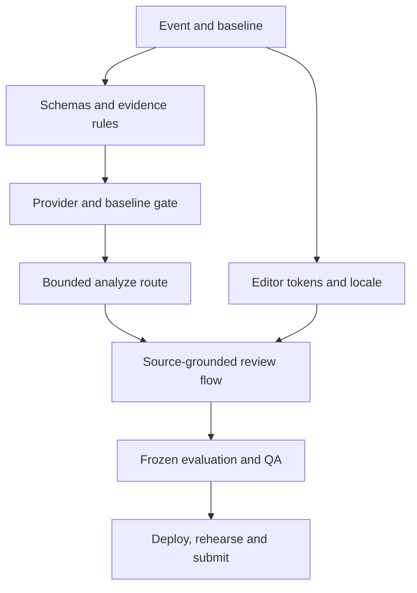

# Implementation dependencies

Most contracts can be written without a key. UI work can consume the schema-valid fixture while provider access is pending, but it is labelled mocked. A failed proof does not justify reporting completion. Complete independent environment/locale work while blocked, and decide whether the core claim still has a credible path before expanding.

Source-of-truth task dependencies are IDs in tasks.json, checked for existence, cycles and chronological feasibility by the documentation audit. Runtime imports are not all represented as task edges; module ownership and contracts carry the detailed source boundaries.
