# Reference sprint Gantt

This illustrative clock starts at midnight for rendering only. Task registry uses relative elapsed time. Actual event submission still ends 19 November at 13:30 IST, so a late start requires the compressed solo plan.

```mermaid
gantt
  title Allowed-team 24-hour reference sprint
  dateFormat HH:mm
  axisFormat %H:%M
  section Kaif
  Setup and feasibility :k1, 00:00, 3h
  Contracts API evidence :k2, after k1, 2h
  Core hardening and evaluation :k3, after k2, 10h
  Freeze release and pitch :k4, after k3, 5h
  Submission and recovery :k5, after k4, 4h
  section Aasim
  Editor tokens and locale :a1, 00:00, 3h
  Evidence UI and integration :a2, after a1, 2h
  Browser QA and evaluation :a3, after a2, 10h
  Release UI and pitch :a4, after a3, 5h
  Verification and recovery :a5, after a4, 4h
```

Blocks include rest/contingency from the minute schedule. The chart is a summary and does not imply full utilisation. IC1 at H3, IC2 at H4:30, IC4 at H15 and IC5 at H20 are the integration decisions. Mermaid rendering itself must be inspected in the target viewer.
