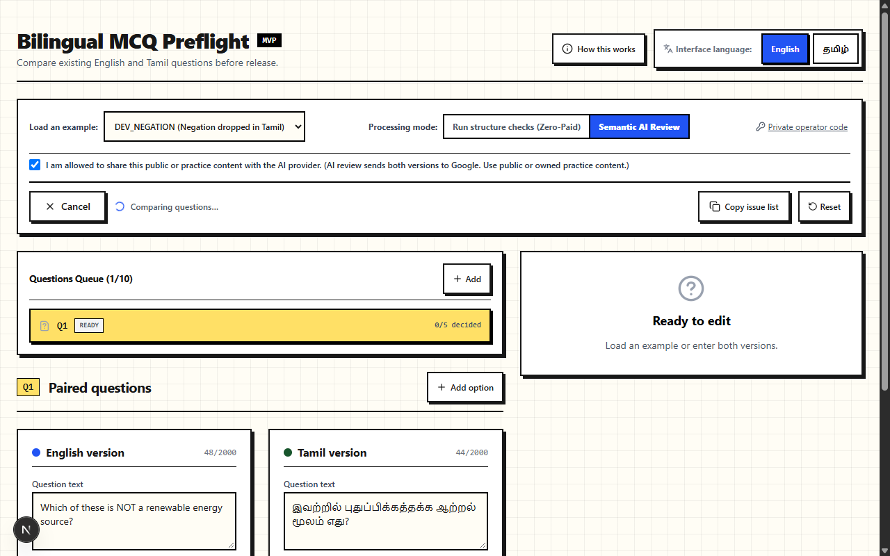
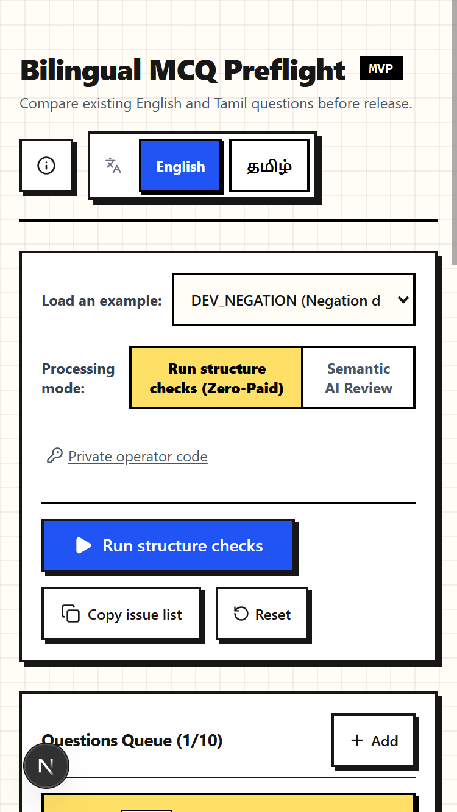
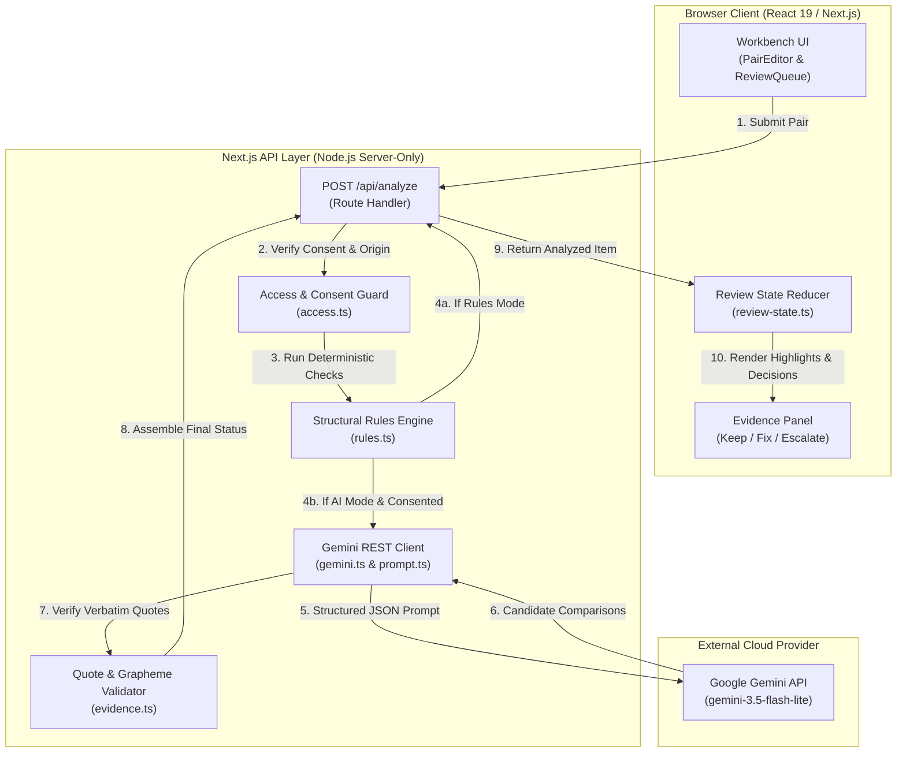
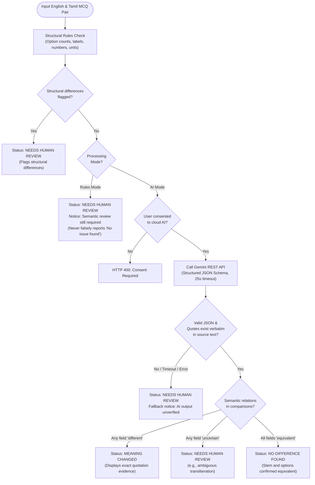
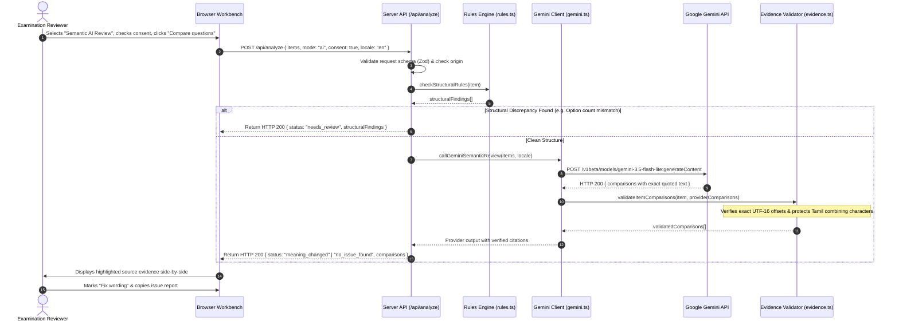

# MozhiMatch — Bilingual MCQ Preflight

**Preflight review workbench for English–Tamil multiple-choice examination papers.**

MozhiMatch is an editorial workbench designed for examination editors, translators, and academic boards who publish bilingual question papers. It verifies paired English and Tamil questions and options side-by-side, detects structural and semantic discrepancies, highlights exact character-level evidence in both source texts, and lets human reviewers record definitive **Keep**, **Fix**, or **Escalate** decisions.

---

## The Problem

In high-stakes bilingual examinations across Tamil Nadu and multilingual entrance bodies (e.g., state recruitment tests, civil service exams, university admissions), questions are presented simultaneously in English and Tamil. Because translation workflows operate under strict publication deadlines, semantic and structural defects regularly slip into live question papers:

- **Dropped Negations:** An English question asking *"Which of the following is NOT a renewable resource?"* translated into Tamil as *"இவற்றில் புதுப்பிக்கத்தக்க ஆற்றல் மூலம் எது?"* (*Which of these IS a renewable resource?*).
- **Inverted Verb Direction:** An English stem stating *"School A received an award from Company B"* translated as *"பள்ளி A நிறுவனம் B-க்கு விருது வழங்கியது"* (*School A gave an award to Company B*).
- **Mismatched Options:** English offers 4 options (A–D), while Tamil provides only 3 (A–C), or option letters are swapped.
- **Numeric & Unit Errors:** Numbers mistranscribed (e.g., "2020" in English vs "2025" in Tamil) or units converted incorrectly (e.g., "m/s" vs "km/h").

When these errors reach candidates, questions become mathematically unanswerable or legally contestable, resulting in post-exam disputes, cancellations, and re-examinations. Manual paper proofreading is tedious, yet full-document automated translation does not respect editorial authority or provide traceable, verifiable evidence.

---

## Concrete Example: Meaning Change Detection

### Input MCQ Pair

| Field | English Version | Tamil Version | Literal Translation of Tamil |
|---|---|---|---|
| **Stem** | Which of these is **NOT** a renewable energy source? | இவற்றில் புதுப்பிக்கத்தக்க ஆற்றல் மூலம் எது? | *Which of these is a renewable energy source?* |
| **Option A** | Solar | சூரிய ஆற்றல் | Solar energy |
| **Option B** | Wind | காற்று ஆற்றல் | Wind energy |
| **Option C** | Coal | நிலக்கரி | Coal |
| **Option D** | Hydropower | நீர்மின் ஆற்றல் | Hydropower |

### What MozhiMatch Flags

- **Status:** `MEANING CHANGED` (`meaning_changed`)
- **Reason Code:** `negation`
- **Source Citations:**
  - English exact quote: `"NOT a renewable energy source"`
  - Tamil exact quote: `"புதுப்பிக்கத்தக்க ஆற்றல் மூலம்"`
- **Explanation:** *"The English question asks which one is NOT a renewable energy source, whereas the Tamil question asks which one IS a renewable energy source, introducing a direct negation discrepancy."*
- **Reviewer Action:** The reviewer clicks **Fix wording** on the stem, flags the missing Tamil negation (*"அல்லாத"*), and copies the formatted editorial issue list for the translation team.

---

## Application Screenshots & Deployment Status

- **Deployment Status:** **Local Demo Verified**. Production build and live browser tests pass locally. Public cloud deployment is pending final domain and infrastructure provisioning.
- **Local URL:** `http://localhost:3000` (via `npm run dev`)

### Desktop Workbench View
Dual-column editor with dynamic character counts, queue management, and character-precise highlighted evidence side-by-side:



### Mobile Viewport View (375px & 390px)
Fully responsive single-column layout adhering strictly to a minimum 44px touch target specification with zero horizontal overflow:



---

## Implemented Features vs. MVP Scope Limitations

### Implemented Features
- **Paired MCQ Editor:** Side-by-side editing of English and Tamil stems (up to 2,000 chars) and labelled options A–E (up to 400 chars).
- **Tamil Typography & Formatting:** Built-in `@fontsource/noto-sans-tamil` font with 1.7 line height for optimal readability.
- **Deterministic Structural Rules (Zero-Cost):** Instant offline checks for option count mismatches, duplicate labels, label order discrepancies, and numeric token differences (including Tamil numerals `௦`–`௯`).
- **Grounded Semantic AI Review:** Server-side Google Gemini analysis (`gemini-3.5-flash-lite`) returning structured JSON evaluations.
- **Exact Citation & Grapheme Protection:** Validates that AI quotes exist verbatim in source text using UTF-16 code unit offsets, ensuring combining vowel signs and virama marks are never split across token boundaries.
- **Human Review Actions:** Reviewers record explicit **Keep**, **Fix**, or **Escalate** decisions on every stem and option finding.
- **Plain-Text Issue Export:** Generates an editorial summary formatted for copy-paste into issue trackers or editorial logs.
- **Bilingual Interface:** Instant interface language toggle between English and தமிழ் with persistent `localStorage` preference.

### Explicit MVP Scope Limitations
- **No PDF or OCR Upload:** Requires manual text input or copy-paste; document parsing is deliberately out of scope for the MVP.
- **No Database or User Accounts:** Session state lives in the browser memory during review; no student data or private papers are permanently stored.
- **No Question Generation or Auto-Translation:** The system reviews and preflights existing human-authored questions; it never generates replacement questions or replaces human editorial judgment.

---

## How It Works

MozhiMatch operates in a four-stage pipeline:

1. **Stage 1 — Deterministic Structure Checks (Zero-Paid):**  
   Runs locally on the server with zero external API calls. Verifies option count equality, option label sets (`A`–`E`), numeric values (converting Tamil digits `௦-௯` to ASCII `0-9`), and measurement units.
2. **Stage 2 — Semantic AI Review (Cloud Gemini, Opt-In):**  
   Requires explicit user consent before transmitting text. The server-only Gemini client calls the REST API with structured response schemas to compare meaning, negation, qualifiers, and answer position alignment.
3. **Stage 3 — Quote Verification & Grapheme Boundary Protection:**  
   The server independently verifies that every quoted snippet returned by Gemini exists verbatim in the raw input text. If quotes do not match or split Tamil grapheme clusters, the finding is safely marked `needs_review`.
4. **Stage 4 — Human Review Decisions:**  
   The reviewer marks each discrepancy as Keep, Fix, or Escalate, and exports an plain-text audit trail.

### Safe Fallback Invariants
- **Rules-Only Never Claims Semantic Equivalence:** In rules mode, when no structural differences are found, the system displays `NEEDS HUMAN REVIEW` with the notice: *"Structure checks found no issue. Semantic review is still required."* It never emits a false "No difference found" badge without semantic analysis.
- **Fail-Safe AI Degradation:** If Gemini is unavailable, times out (25-second limit), returns malformed JSON, or fails quote verification, the question is marked `needs_review`—never silently marked clear.

---

## Architecture

The diagram below reflects the actual implementation across Next.js App Router, server-side modules, and external services:



---

## Decision Logic

This diagram illustrates how MozhiMatch determines the final item status:



---

## Request & Analysis Sequence

The following sequence diagram details an end-to-end Semantic AI Review request:



---

## Repository Structure

```
MozhiMatch/
├── src/
│   ├── app/                 # Next.js App Router pages and API route handlers
│   │   ├── api/analyze/     # Main preflight analysis endpoint (/api/analyze)
│   │   ├── api/health/      # Health check endpoint (/api/health)
│   │   ├── globals.css      # Neobrutalist design tokens and layout styling
│   │   ├── layout.tsx       # Root HTML layout and font definitions
│   │   └── page.tsx         # Main workbench entry view
│   ├── components/          # React components
│   │   ├── LocaleControl.tsx # English / தமிழ் language toggle
│   │   └── workbench/       # Workbench, PairEditor, ReviewQueue, EvidencePanel
│   ├── fixtures/            # Synthetic test and benchmark datasets
│   │   ├── development.json # 5 development split items for interactive use
│   │   ├── holdout-inputs.json # 10 held-out evaluation test items
│   │   └── holdout-expected.json # Expected labels for holdout evaluation
│   ├── i18n/                # Client-side internationalization provider
│   ├── messages/            # Symmetric translations (en.json, ta.json)
│   └── lib/                 # Core domain logic and server modules
│       ├── ai/              # Server-only Gemini client and structured prompts
│       ├── contracts/       # Zod schemas and TypeScript interfaces
│       ├── core/            # Rules engine, evidence validator, and export formatter
│       └── server/          # Origin validation and constant-time operator authentication
├── tests/
│   ├── api/                 # API route and workflow integration tests
│   └── unit/                # Unit tests for rules, evidence, access, export, and contracts
├── docs/                    # Technical documentation
│   ├── ARCHITECTURE.md      # System architecture and data flow
│   ├── API_CONTRACTS.md     # Endpoint contracts and payload specifications
│   ├── PRIVACY.md           # Security, data minimization, and privacy model
│   ├── EVALUATION.md        # Benchmark evaluation plan and methodology
│   ├── DEPLOYMENT.md        # Vercel deployment runbook
│   └── examples/            # Validated JSON request/response contract examples
├── evaluation/              # Benchmark result logs and browser verification screenshots
├── public/                  # Static assets (favicon.svg, robots.txt)
└── scripts/
    └── evaluate.ts          # Automated benchmark runner (development & holdout)
```

---

## Tech Stack

| Technology | Role | Reason for Choice |
|---|---|---|
| **Next.js 16 (App Router)** | Full-Stack Framework | Native server-only execution prevents API key exposure; fast Turbopack compilation. |
| **React 19** | UI Library | Modern component rendering, state reducers, and seamless hydration. |
| **TypeScript 5.9** | Language | Strict compile-time contracts across API requests, responses, and state reducers. |
| **Tailwind CSS 4** | Styling | Utility-first CSS powering the high-contrast neobrutalist paper-and-ink aesthetic. |
| **Google Gemini REST API** | Semantic Reasoning | Low-latency inference (`gemini-3.5-flash-lite`), structured JSON output, strong Tamil script handling. |
| **Zod 4** | Schema Validation | Validates client inputs, server responses, and untrusted LLM outputs at runtime. |
| **Vitest 5** | Test Framework | Fast native ESM and TypeScript unit testing with zero build overhead. |
| **Noto Sans Tamil & Geist** | Web Typography | High-legibility Tamil rendering with appropriate line spacing (`1.7`) for vowel diacritics. |

---

## Local Setup & Installation

### Prerequisites
- **Node.js:** `>= 24.0.0`
- **npm:** `>= 10.0.0`
- **Modern Browser:** Chrome, Edge, Firefox, or Safari

### 1. Clone the Repository
```bash
git clone https://github.com/mohamed-kaif-1/MozhiMatch.git
cd MozhiMatch
```

### 2. Install Dependencies
```bash
npm install
```

### 3. Configure Environment Variables
Copy the example environment configuration:

**Windows PowerShell:**
```powershell
Copy-Item .env.example .env.local
```

**macOS / Linux Bash:**
```bash
cp .env.example .env.local
```

Edit `.env.local` with your configuration. *(Note: The application runs fully in structural Rules Mode even without an API key).*

### 4. Run the Development Server
```bash
npm run dev
```
Open [http://localhost:3000](http://localhost:3000) in your browser.

---

## Environment Variables

| Variable | Type | Default | Description |
|---|---|---|---|
| `AI_MODE` | `"on" \| "off"` | `"off"` | Enables or disables cloud AI calls. If `"off"`, runs deterministic rules only. |
| `GEMINI_API_KEY` | `string` | `""` | Google Gemini API key. Server-only; never leaked to client bundles. |
| `GEMINI_MODEL` | `string` | `"gemini-3.5-flash-lite"` | Candidate Gemini model identifier. |
| `DEPLOYMENT_MODE` | `"local" \| "public_demo"` | `"local"` | In `"public_demo"`, live AI is restricted to server-owned allowlist fixtures unless a demo code is provided. |
| `APP_ORIGIN` | `string` | `"http://localhost:3000"` | Allowed client origin for CSRF and request validation. |
| `DEMO_ACCESS_CODE` | `string` | `""` | Optional secret operator code verified via `crypto.timingSafeEqual` to allow custom AI queries in public demo mode. |

---

## Testing & Quality Assurance

All verification commands are executed against the actual codebase:

```bash
# 1. Run all unit and integration tests (Vitest)
npm run test

# 2. Run TypeScript typecheck (tsc)
npm run typecheck

# 3. Run ESLint (eslint)
npm run lint

# 4. Run production build (Next.js)
npm run build

# 5. Run development evaluation split benchmark
npm run eval:development

# 6. Run holdout evaluation split benchmark
npm run eval:holdout
```

### Verified Test Results
- **Automated Tests:** **9 test files, 44 tests passed** (100% pass rate in ~1.8 seconds).
- **TypeScript:** `0` type errors across all strict modules.
- **ESLint:** `0` lint errors and `0` warnings.
- **Production Build:** Next.js static and dynamic route optimization succeeds with zero errors.
- **Real Browser Testing (CDP):** Verified in Google Chrome at 1280px, 390px, and 375px viewports. **0 horizontal scroll** (`scrollWidth === clientWidth = 375px`), and all **28 / 28 interactive touch targets satisfy the ≥ 44px standard**.

### Dataset & Evaluation Disclosures
- **Synthetic Test Data:** Practice items in `src/fixtures/development.json` and `src/fixtures/holdout-inputs.json` are original synthetic authored questions to avoid distributing copyrighted examination material.
- **Sample Size Limitation:** Benchmark evaluations are performed on small, carefully authored control sets (5 development items, 10 holdout items); performance on large-scale real-world examination papers will require broader domain-specific tuning.
- **Live AI Verification:** Real live Gemini calls were executed and verified via Chrome DevTools network interception returning `mode: "live_ai"`, `providerStatus: "ok"`, and exact UTF-16 quotation spans.

---

## Deployment Guide

### Vercel Deployment (Recommended)
1. Push the repository to GitHub.
2. Import the repository in [Vercel](https://vercel.com).
3. Set the following environment variables in the Vercel dashboard:
   - `AI_MODE`: `"on"` (or `"off"` for zero-cost deployment)
   - `GEMINI_API_KEY`: `<your_gemini_api_key>`
   - `GEMINI_MODEL`: `"gemini-3.5-flash-lite"`
   - `DEPLOYMENT_MODE`: `"public_demo"`
   - `APP_ORIGIN`: `"https://your-domain.vercel.app"`
   - `DEMO_ACCESS_CODE`: `<your_secret_operator_code>`
4. Deploy. Vercel automatically compiles static routes and dynamic API endpoints.

> [!NOTE]
> In `public_demo` mode, arbitrary public web visitors can test the 5 built-in examination fixtures with live AI, preventing API quota exhaustion. Reviewers entering custom questions can unlock full live AI analysis by entering the private operator demo code.

---

## Privacy & Security

- **Data Minimization:** No database is attached to MozhiMatch. Questions, stems, and options reside strictly in volatile client memory and are discarded when the tab is closed or reset.
- **Explicit Cloud Consent:** Question text is **never** sent to Google Gemini unless the user explicitly checks the consent box (*"I consent to sending question text to Gemini for semantic review"*).
- **Server-Only Secrets:** `GEMINI_API_KEY` is loaded exclusively inside server-side route handlers protected by `import "server-only"`. It is never bundled into client-side JavaScript.
- **Timing-Safe Authentication:** Operator demo codes are verified using constant-time string comparisons (`crypto.timingSafeEqual`) to protect against side-channel timing attacks.

---

## 1-Minute Judge Walkthrough

To review MozhiMatch in approximately 60 seconds:

1. **Inspect UI:** Open [http://localhost:3000](http://localhost:3000). Notice the bilingual neobrutalist interface, paired question columns, and typography.
2. **Load Fixture:** In the top toolbar, select `DEV_NEGATION (Negation dropped in Tamil)`.
3. **Run Rules Mode:** Keep the default mode as *"Run structure checks (Zero-Paid)"* and click **Run structure checks**. Notice that the status reports `NEEDS HUMAN REVIEW` with an explicit notice that semantic review is required (it never claims a false clear).
4. **Trigger Semantic AI:** Switch the mode toggle to **Semantic AI Review**, check the consent box, and click **Compare questions**.
5. **Inspect Citations:** Within ~2 seconds, observe the badge change to `MEANING CHANGED`. In the right panel, observe the side-by-side exact yellow highlights on `"NOT a renewable energy source"` and `"புதுப்பிக்கத்தக்க ஆற்றல் மூலம்"`.
6. **Record Human Decision:** Click **Fix wording** on the stem discrepancy.
7. **Export Issue Report:** Click **Copy issue list**. Paste into any text editor to inspect the plain-text audit report.
8. **Toggle Language:** Click **தமிழ்** in the top navigation bar to confirm instant bidirectional interface localization.

---

## Known Limitations & Roadmap

- **Manual Input Only:** Does not yet support bulk PDF question paper ingestion or OCR scanning.
- **Small Evaluation Split:** Benchmark results are established on small synthetic control suites; large-scale validation across historical exam archives is planned.
- **Roadmap:**
  - [ ] Add direct CSV/JSON batch import for examination authoring teams.
  - [ ] Support custom institutional glossary enforcement (e.g., standard scientific terminology mappings).
  - [ ] Generate downloadable PDF preflight certification audit reports.

---

## License & Acknowledgments

- **Status:** Hackathon submission code repository.
- **Typography:** Uses Google Fonts' [Noto Sans Tamil](https://fonts.google.com/specimen/Noto+Sans+Tamil) and Vercel's [Geist](https://vercel.com/font).
- **Icons:** [Lucide Icons](https://lucide.dev/).
