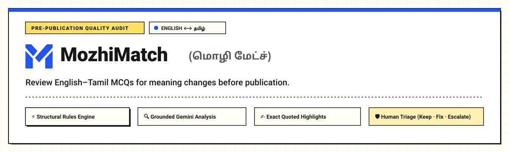
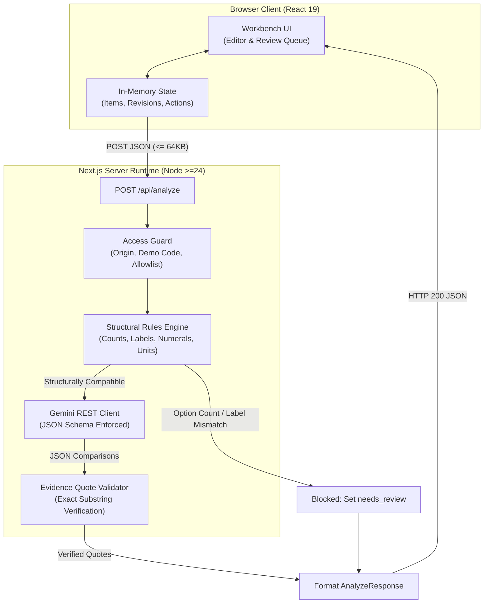
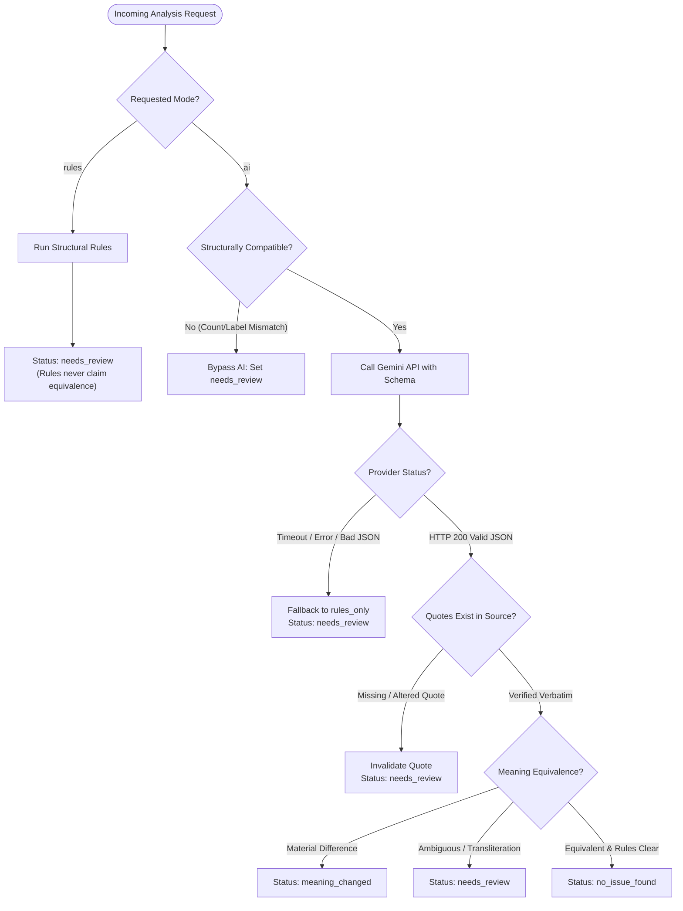

<div align="center">



# MozhiMatch (மொழி மேட்ச்)

**Review English–Tamil MCQs for meaning changes before publication.**

[](https://nextjs.org/)
[](https://www.typescriptlang.org/)
[](https://nodejs.org/)
[](https://ai.google.dev/)
[-047857?style=flat-square)](final-audit/00-executive-verdict.md)

[Quick Start](#quick-start) • [Workflow](#workflow) • [Architecture](docs/ARCHITECTURE.md) • [Final Audit Report](final-audit/00-executive-verdict.md) • [Engineering Decisions](#engineering-decisions--trade-offs) • [Verification](#verification--evidence) • [Privacy](docs/PRIVACY.md)

</div>

---

### Availability & Deployment Status

- **Live Public Demo**: [https://mozhimatch.vercel.app/](https://mozhimatch.vercel.app/) — Live production deployment on Vercel with serverless Gemini integration.
- **Judge Quick Test (No Password Required)**: Judges can evaluate live Semantic AI Review and AI Correction Suggestions directly on built-in sample fixtures without entering any access code.
- **Full Automation QA Gate**: 15/15 Vitest test files passing (113/113 tests) + 16/16 Playwright browser tests passing (100%) across 7 viewports.

---

## What is MozhiMatch?

MozhiMatch is a quality preflight workbench for bilingual exam editors, translators, and educators who review paired multiple-choice questions (MCQs) in **English** and **Tamil**.

During rapid translation, subtle shifts—such as an omitted negation, a flipped verb, or a numerical discrepancy—can alter the answer key or invalidate a question. MozhiMatch audits paired questions before publication, pairing fast deterministic structural checks with structured Google Gemini semantic comparison and strict verbatim quote validation.

Reviewers retain final authority: every finding highlights the exact source excerpt and surfaces rapid **Keep**, **Fix**, or **Escalate** triage actions.

---

## Product in Action


*Figure 1: MozhiMatch desktop workbench reviewing synthetic fixture `DEV_NEGATION`. The left column captures the English stem asking "Which of these is NOT a renewable energy source?" and the Tamil stem omitting the negative particle ("இவற்றில் புதுப்பிக்கத்தக்க ஆற்றல் மூலம் எது?"). The right column validates and highlights the exact Tamil question text, flags the missing negation, and presents Keep / Fix / Escalate actions.*

---

## The Problem: Subtle Semantic Drift

In bilingual assessments, minor translation omissions create material discrepancies between language cohorts:

| Language Version | Question Text | Answer Key Implication |
|---|---|---|
| **English Original** | Which of these is **NOT** a renewable energy source?<br>`A: Solar` &nbsp; `B: Wind` &nbsp; `C: Coal` &nbsp; `D: Hydropower` | Exactly one correct answer (**C: Coal**). |
| **Flawed Tamil Translation** *(Synthetic Example: `DEV_NEGATION`)* | இவற்றில் புதுப்பிக்கத்தக்க ஆற்றல் மூலம் எது? *(Which of these is a renewable energy source?)*<br>`A: சூரிய ஆற்றல்` &nbsp; `B: காற்று ஆற்றல்` &nbsp; `C: நிலக்கரி` &nbsp; `D: நீர்மின் ஆற்றல்` | Three valid answers (**A, B, D**); question is broken and ungradable. |
| **Reviewer Triage Action** | **Fix / Escalate**: Restore missing negative particle (`அல்லாத`) in Tamil stem: *"இவற்றில் புதுப்பிக்கத்தக்க ஆற்றல் மூலம் அல்லாதது எது?"* | Single correct answer restored across both language papers. |

---

## Workflow

```
[1. Enter or Import Pair] ──> [2. Run Checks] ──> [3. Inspect Evidence & Filter] ──> [4. Record & Export]
```

1. **Enter or Import Paired Questions**: Input English and Tamil question stems alongside options (`A`–`D` or `E`), or click **Import CSV** to upload up to 10 questions at once with live validation preview.
2. **Run Checks**: Execute instant structural rules or run semantic AI comparison with explicit reviewer consent.
3. **Inspect Evidence & Filter**: Review flagged discrepancies alongside exact quoted substrings. Use the batch summary bar to filter questions by status (`Changed`, `Review`, `Clean`, `Draft`).
4. **Record & Export**: Mark findings as **Keep**, **Fix**, or **Escalate**, then copy a structured Markdown summary or click **Download CSV report** for an RFC 4180 spreadsheet report.

### Operating Modes & Human Triage

| Mode / Action | Scope & Execution | Guaranteed Safety Properties |
|---|---|---|
| **Rules Mode** | Instant local deterministic checks (option counts, label alignment, Tamil numerals `௦–௯`, numbers, and units). | Always returns `needs_review`. Never claims semantic equivalence without AI verification. |
| **Semantic AI Mode** | Structured cloud comparison via Google Gemini (`gemini-2.5-flash`) requiring reviewer consent. | Strictly validates that every quoted excerpt exists verbatim in the source text before display. |
| **AI Correction Suggestions** | In-context editorial fixes for detected discrepancies (`different` / `uncertain`) with inline diff and editable textarea. | Reviewer-controlled: one-click "Apply to editor" modifies Tamil stem/option with instant "Undo correction" revert safety. |
| **Public Judge Demo Access** | Password-free immediate AI evaluation on approved server-side fixtures (`DEV_NEGATION`, `DEV_VERB`, `DEV_CLEAN`, `DEV_UNCERTAIN`, `DEV_STRUCTURE`). | Zero friction for judges while rejecting anonymous tampered inputs with HTTP 403 `DEMO_INPUT_RESTRICTED`. |
| **Private Operator Mode** | Unrestricted AI analysis and corrections on custom entered questions via secure operator code. | Constant-time access check (`crypto.timingSafeEqual`) and atomic Upstash Redis rate limiting. |
| **Batch CSV Import** | RFC 4180 CSV parser supporting UTF-8 Tamil, BOM, multiline cells, and option parity validation. | Atomic import: all errors are surfaced in a preview modal before applying; never silently drops invalid rows. |
| **Batch CSV Export** | Complete findings report with UTF-8 BOM and spreadsheet formula injection protection. | One row per finding, plus summary rows for clean questions so no item disappears. Escapes `=`, `+`, `-`, `@`. |
| **Human Triage** | Reviewer assigns **Keep** (intended phrasing), **Fix** (editorial correction), or **Escalate** (panel review). | Automated checks surface candidate issues; the human reviewer decides editorial action. |

---

## System Engineering

MozhiMatch is implemented as a single, stateless Next.js 16 application. State is held in browser memory, and server routes execute statelessly without a database.

### System Architecture



### Result Classification Flow



*For complete component boundaries and request sequence details, see [docs/ARCHITECTURE.md](docs/ARCHITECTURE.md).*

---

## Engineering Decisions & Trade-Offs

1. **Deterministic Rules Alongside Model Comparison**:
   - *Design*: Regex token checks (counts, labels, Tamil numerals `௦–௯`, numbers, units) execute before the LLM. Only structural blockers (`OPTION_COUNT_MISMATCH`, `OPTION_LABEL_MISMATCH`, `DUPLICATE_OPTION_LABEL`) bypass AI.
   - *Trade-off*: Token matching cannot detect semantic nuance, but it catches formatting defects in <5ms without API costs.
2. **Exact Substring Evidence Validation**:
   - *Design*: The API route validates that every quoted string in Gemini's response exists verbatim in the source text before returning highlights.
   - *Trade-off*: Paraphrased quotes invalidate the comparison and trigger `needs_review`. *Note*: verifying a quote exists proves grounding, not that the model's interpretation of that quote is correct.
3. **Fail-Safe "Needs Review" Fallback**:
   - *Design*: Any model timeout, parse error, structural mismatch, or quote failure marks the item `needs_review`. Rules-only mode strictly returns `needs_review`.
   - *Trade-off*: Reviewers inspect more items during provider degradation, but silent false clears are eliminated.

---

## Quick Start

### Prerequisites
- **Node.js**: `>=24.0.0`
- **Package Manager**: `npm`
- **Google Gemini API Key**: from [Google AI Studio](https://aistudio.google.com/)

### 1. Clone & Install
```powershell
# PowerShell
git clone https://github.com/mohamed-kaif-1/MozhiMatch.git
cd MozhiMatch
npm ci
```
*(macOS / Linux: run identical commands in `bash` / `zsh`)*

### 2. Configure Environment
```powershell
# PowerShell
Copy-Item .env.example .env.local

# macOS / Linux: cp .env.example .env.local
```

Edit `.env.local`:
```bash
AI_MODE=gemini
GEMINI_API_KEY=your_gemini_api_key_here
GEMINI_MODEL=gemini-2.5-flash
DEPLOYMENT_MODE=local
APP_ORIGIN=http://localhost:3000
DEMO_ACCESS_CODE=
```

### 3. Run Development Server
```bash
npm run dev
```
Open **[http://localhost:3000](http://localhost:3000)** in your browser.

---

## Environment Variables

| Variable | Required | `.env.example` | Runtime Default | Purpose |
|---|---|---|---|---|
| `AI_MODE` | No | `off` | `"off"` | Set to `gemini` to enable live AI review; `off` restricts to rules-only mode. |
| `GEMINI_API_KEY` | Yes (for AI) | *(empty)* | `undefined` | Google AI Studio API key used for Gemini REST calls. |
| `GEMINI_MODEL` | No | `gemini-3.5-flash-lite` | `"gemini-2.5-flash"` | Gemini model identifier for Google REST API requests. |
| `DEPLOYMENT_MODE` | No | `public_demo` | `"local"` | In `public_demo` mode, restricts AI analysis strictly to allowlisted fixtures. |
| `APP_ORIGIN` | No | `http://localhost:3000` | Same-origin | Validates request origin header on incoming POST requests. |
| `DEMO_ACCESS_CODE` | No | *(empty)* | Open access | Secret passphrase verified via `crypto.timingSafeEqual` for hosted demos. |

> [!IMPORTANT]
> **Public Demo Restrictions:** When `DEPLOYMENT_MODE="public_demo"`, entering a valid `DEMO_ACCESS_CODE` verifies operator credentials but does **not** bypass the fixture allowlist. Custom entered items are rejected with `403 DEMO_INPUT_RESTRICTED` to prevent prompt injection or unmonitored API usage.

---

## Verification & Evidence

MozhiMatch maintains clear separation between test suites, browser testing, and offline fixture utilities:

| Check | Result | Location / Command | Scope & Notes |
|---|---|---|---|
| **Unit & Contract Tests** | **113 / 113 Passing** (15 suites) | `npm run test` | Validates CSV import/export, Zod contracts, structural rules, evidence quotes, exports, access guards, rate limiting, global budget, AI suggestions, and review state transitions. |
| **Static Quality Gates** | **0 Errors, Clean Build** | `npx tsc --noEmit`<br>`npm run lint`<br>`npm run build` | TypeScript 5.9 strict typecheck (0 errors), ESLint 9 (0 errors/0 warnings), and Next.js 16 production Turbopack compilation. |
| **Automated Chrome Browser QA** | **16 / 16 Passing (100%)** | `node scripts/run_production_qa.mjs` | Automated multi-viewport audit across 7 screen widths (320px–1920px), zero toolbar overlap, state synchronization, live AI review, suggest-apply-undo correction workflow, reviewer triage, rules checks, CSV export, and Tamil localization. |
| **Live AI Benchmark** | **1.000 Precision, 0.923 F1** | `final-audit/02-semantic-benchmark.md` | 30 frozen benchmark cases. 0.000 False Negative Rate on bad questions. Resisted adversarial prompt injection attacks that compromised generic LLMs. |
| **Live AI Provider Calls** | **Verified (`mode: live_ai`)** | Chrome Network Inspection | Confirmed HTTP 200 from Google Generative Language API, valid JSON schema compliance, and verbatim evidence matching. |
| **Production Evaluator** | **Honest Execution Utility** | `scripts/evaluate.ts`<br>`npm run eval:development`<br>`npm run eval:holdout` | Evaluates production structural rules without hardcoded answers. Opt-in `--mode live_ai` executes real Gemini calls with quote validation; if API keys are missing, results are explicitly marked `not_run` without fake labels. |
| **Public Cloud Deployment** | **Live Production (Vercel)** | [https://mozhimatch.vercel.app/](https://mozhimatch.vercel.app/) | Deployed on Vercel with serverless edge rate limiting, atomic Upstash Redis counters, and password-free judge demonstration access. |

*Verified on branch `main`.*

---

## Mobile Viewport Audit

<div align="center">


*Figure 2: Verified 375px mobile viewport audit (`evaluation/mobile-375-verified.png`). Document width matches viewport width exactly (375px clientWidth / 375px scrollWidth, 0px overflow). All touch targets meet the 44px minimum touch target standard across both English and Tamil interfaces.*

</div>

---

## Tech Stack

| Layer | Technology | Version | Role |
|---|---|---|---|
| **Framework** | Next.js (App Router) | `16.4.6` | Full-stack React framework providing SSR, Turbopack, and server route handlers. |
| **UI Runtime** | React & React DOM | `19.3.1` | Component-level state and form handling. |
| **Styling** | Tailwind CSS & PostCSS | `4.3.5` | Neo-brutalist variables (`#FFFDF5` paper, `#171717` ink, `#2154F4` blue). |
| **Typography** | Geist & Noto Sans Tamil | `5.3.0` | Bilingual typography with specialized Tamil line heights (`1.7`). |
| **Validation** | Zod | `4.6.7` | Compile-time and runtime validation for API schemas and Gemini responses. |
| **CSV Engine** | PapaParse | `5.7.1` | RFC 4180 compliant CSV parser and serializer with multiline and UTF-8 BOM support. |
| **AI Integration** | Google Gemini REST API | Beta | Direct server-side REST integration with JSON schema enforcement. |
| **Localization** | `next-intl` | `4.15.1` | Instant English and Tamil interface switching. |
| **Testing** | Vitest & Playwright | `5.1.1` / `1.65.1` | Fast unit tests and browser automation. |

---

## Repository Structure

```
MozhiMatch/
├── docs/                      # Technical documentation
│   ├── assets/                # Presentation assets (banner.svg, banner.png)
│   ├── ARCHITECTURE.md        # Architecture, sequence diagrams & failure modes
│   ├── API_CONTRACTS.md       # API schemas, CSV import/export contracts & error codes
│   ├── DEPLOYMENT.md          # Local & Vercel deployment guide
│   ├── EVALUATION.md          # Evaluation framework & evaluator mode specifications
│   ├── PRIVACY.md             # Privacy boundaries & data handling
│   └── examples/              # Sample JSON request and response payloads
├── evaluation/                # Verified screenshots & fixture CSVs
│   ├── desktop-verified.png   # Desktop workbench verification screenshot
│   ├── mobile-375-verified.png# 375px mobile audit screenshot
│   ├── results-development.csv# Honest development evaluation output
│   └── results-holdout.csv    # Honest holdout evaluation output
├── scripts/                   # Development utilities
│   └── evaluate.ts            # Production evaluator (structural rules & opt-in live AI)
├── src/
│   ├── app/                   # Next.js App Router (workbench UI & API routes)
│   ├── components/workbench/  # Workbench UI components & CsvImportModal
│   ├── fixtures/              # Synthetic test fixtures (development & holdout)
│   ├── i18n/                  # Bilingual locale provider
│   ├── lib/                   # AI client, contracts, rules, server guards, CSV engines
│   └── messages/              # English (`en.json`) and Tamil (`ta.json`) translations
├── tests/                     # Automated Vitest test suites (15 suites, 113 tests)
├── package.json               # Project manifest, scripts, and dependencies
└── README.md                  # Project documentation & presentation
```

---

## Implementation Boundaries & Limitations

- **Manual Text Entry Only**: Accepts typed or pasted text. Does not include OCR, PDF parsing, or automated document ingestion.
- **No Machine Translation**: Audits existing translations; does not generate translations or author questions.
- **In-Memory State**: Workbench state exists solely in browser memory; refreshing clears data. No persistent database or user accounts.
- **Model Disclaimers**: LLM comparisons are advisory recommendations. Quoted evidence ensures grounding, but human review (Keep/Fix/Escalate) is required.
- **Evaluation Dataset**: Fixtures consist of 5 development items and 10 holdout items. Broad statistical benchmarks across thousands of items require future multi-center testing.

---

## Data Privacy

- **Client-Side**: Question text and review decisions reside exclusively in browser memory. Only UI locale (`bmcq.locale`) persists in `localStorage`.
- **Server-Side**: The Next.js backend does not store, log, or cache submitted question text or review decisions.
- **Provider Boundary**: When Semantic AI mode is triggered with consent, text is transmitted over HTTPS to Google's Generative Language API under Google Cloud's data handling policies. Upcoming confidential exam drafts should not be submitted on public deployments. See [docs/PRIVACY.md](docs/PRIVACY.md).

---

## Brand Assets

The MozhiMatch visual identity features the reconstructed geometric ribbon-folded **M** mark in solid brand blue (`#2154F4`) with wide negative space gaps and neobrutalist styling.

| Asset | Format | Preview | Description |
|---|---|---|---|
| **Horizontal Logo** | [SVG](public/brand/logo-horizontal.svg) · [PNG (2x)](public/brand/logo-horizontal.png) |  | Primary lockup with geometric M mark and bold wordmark |
| **Monochrome Black** | [SVG](public/brand/logo-horizontal-mono-black.svg) · [PNG](public/brand/logo-horizontal-mono-black.png) |  | High-contrast dark neutral (`#171717`) for light print |
| **Monochrome White** | [SVG](public/brand/logo-horizontal-mono-white.svg) · [PNG](public/brand/logo-horizontal-mono-white.png) |  | Inverted white (`#FFFFFF`) for dark backgrounds |
| **Icon Only** | [SVG](public/brand/logo-icon.svg) · [PNG (512x512)](public/brand/logo-icon.png) |  | Standalone geometric mark in solid blue (`#2154F4`) |
| **Favicons** | [SVG](public/favicon.svg) · [ICO](public/favicon.ico) · [PNG](public/apple-touch-icon.png) |  | Multi-size favicon (16px, 32px, 48px, 180px apple-touch-icon) |

---

## Roadmap

- [x] **Batch CSV Import / Export**: Review examination question papers (up to 10 questions per batch) with instant CSV import validation, preview, and results download.
- [ ] **Offline Local LLM Support**: Add adapter for local inference engines (Ollama / ONNX) for air-gapped exam boards.
- [ ] **Multi-Reviewer Audit Trail**: Export structured JSON-LD reports with reviewer signatures and timestamped decisions.

---

## Author & Acknowledgments

- **Lead Engineer & Maintainer**: Mohamed Kaif ([@mohamed-kaif-1](https://github.com/mohamed-kaif-1))
- **Core Dependencies**: Next.js (Vercel), Google Gemini API, Tailwind CSS, Lucide Icons, Vitest.

---

## License

Private hackathon submission repository. All rights reserved.
