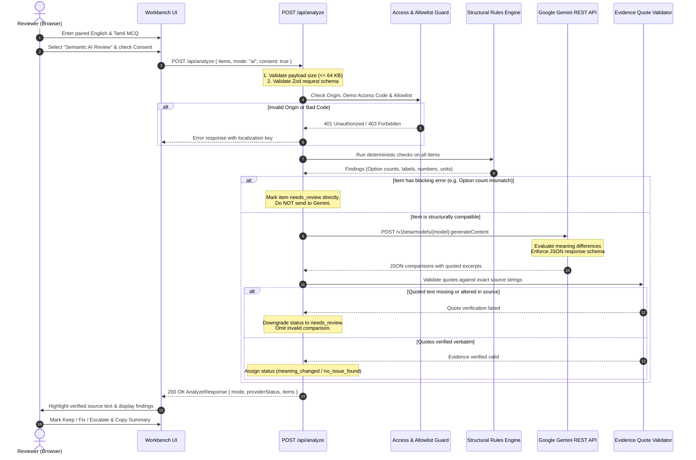

# System Architecture

MozhiMatch is implemented as a single, stateless Next.js 16 application with an editorial Neo-brutalist client workbench and a hardened server route handler. It pairs fast, deterministic structural rules with a structured Google Gemini semantic comparison and strict verbatim quote validation.

---

## Component Boundaries

| Component | Path | Responsibility | Execution Environment |
|---|---|---|---|
| **Client Workbench** | `src/app/page.tsx` `src/components/workbench/` | In-memory dual-column editor, revision tracking, optimistic status, review queue, touch-hardened triage actions (Keep / Fix / Escalate), and clipboard export. | Browser (React 19, Client Component) |
| **Analysis Route Handler** | `src/app/api/analyze/route.ts` | Request limits, JSON validation, origin check, demo access control, fixture allowlist verification, rule execution, provider orchestration, and evidence verification. | Server-only Node runtime |
| **Structural Rules Engine** | `src/lib/core/rules.ts` | Pure deterministic checks: option count parity, duplicate labels, label set match, Tamil numeral normalization (௦–௯ to 0–9), numeric tokens, and unit tokens. | Shared (Isomorphic) |
| **Semantic AI Client** | `src/lib/ai/gemini.ts` `src/lib/ai/prompt.ts` | Generates prompt with system constraints, invokes Google Generative Language REST API with strict JSON schema enforcement (`responseMimeType: "application/json"`). | Server-only Node runtime |
| **Evidence Quote Validator** | `src/lib/core/evidence.ts` | Verifies that every English and Tamil excerpt quoted by the model exists verbatim as an exact substring in the source text. | Server-only Node runtime (orchestrated by route) |
| **Access & Demo Guard** | `src/lib/server/access.ts` | Timing-safe demo access code validation (`crypto.timingSafeEqual`), origin verification, and fixture allowlist filtering in `public_demo` mode. | Server-only Node runtime |
| **Health Route** | `src/app/api/health/route.ts` | Reports server deployment mode and AI availability status without disclosing secrets. | Server-only Node runtime |

---

## End-to-End Request Sequence Diagram

The following sequence diagram details the full lifecycle of a review request across client, server route handler, access controls, structural rules, Gemini provider, and quote validator.

---

## Gatekeeping and Failure Modes

1. **Content-Type & Body Size**:
   Requests must specify `application/json` and must not exceed `APP_LIMITS.MAX_REQUEST_BYTES` (64,000 bytes). Violations return `415 UNSUPPORTED_MEDIA_TYPE` or `413 BODY_TOO_LARGE`.
2. **Structural Blocking**:
   Only three structural conditions block AI inference:
   - `OPTION_COUNT_MISMATCH` (e.g., 4 English options vs 3 Tamil options)
   - `OPTION_LABEL_MISMATCH` (e.g., options labelled A, B, C, D in English vs A, B, C, E in Tamil)
   - `DUPLICATE_OPTION_LABEL` (e.g., two option A's on either side)
   Numeric and unit differences are surfaced as advisory structural findings but do **not** block semantic review.
3. **Provider Failures**:
   If Gemini times out (25-second server timeout) or returns invalid JSON, the route automatically falls back to `mode: "rules_only"` with provider status `unavailable` or `timeout`, setting item status to `needs_review`. The system **never** marks an item clear on provider failure.
4. **Public Demo Restrictions**:
   When `DEPLOYMENT_MODE="public_demo"`, `validateDemoAllowlist()` checks that submitted items exist in `src/fixtures/development.json`. Custom user-entered questions are rejected with `403 DEMO_INPUT_RESTRICTED`. Entering a valid operator `x-demo-code` verifies operator credentials but does **not** bypass the fixture allowlist in `public_demo` mode.
